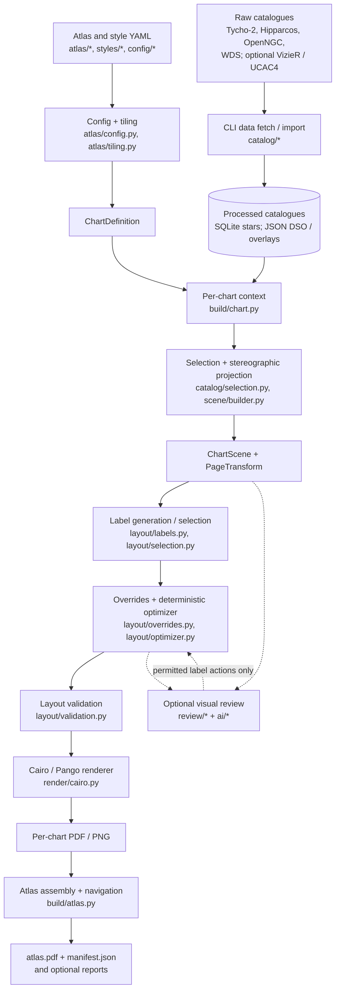

# NightSkyAtlas — Architecture Overview

> Code-based overview of `fcarron/nightsky-atlas`, branch `main`, commit `62a3f52` (reviewed 2026-10-13).
> This is the *implementation map*. For detailed constraints and design decisions, see [ARCHITECTURE.md](ARCHITECTURE.md) and [AGENTS.md](../AGENTS.md).

## Purpose and shape

NightSkyAtlas is a Python 3.12 **CLI-driven, offline atlas generator**, not a web application. It converts astronomical catalogues and edition-specific YAML configuration into printable **vector PDF** sky charts and optional PNG previews. The core production path is deterministic; AI-based visual review is optional.

## System flow

The diagram represents the logical data flow, not every internal function call. The atlas builder coordinates chart building, parallel workers and PDF assembly.

## Main modules

| Package / file | Responsibility | Main entry points |
| --- | --- | --- |
| [`cli.py`](../src/nightsky_atlas/cli.py) | Command-line interface for data, chart, atlas, benchmark and research operations | `main`, `build_parser` |
| [`catalog/`](../src/nightsky_atlas/catalog/) | Import, normalize, merge, store and select astronomical objects, including edition visibility rules | `StarStore`, `select_dso` |
| [`atlas/`](../src/nightsky_atlas/atlas/) | Typed YAML configuration, tiling, neighbours, overview pages and index | `chart_definitions`, `coverage_report` |
| [`projection/`](../src/nightsky_atlas/projection/) and [`chart/`](../src/nightsky_atlas/chart/) | Stereographic projection, chart geometry and conversion to page millimetres | `StereographicProjection`, `ChartDefinition`, `PageTransform` |
| [`scene/`](../src/nightsky_atlas/scene/) | Select and project chart objects without deciding final label placement | `build_scene`, `ChartScene` |
| [`layout/`](../src/nightsky_atlas/layout/) | Label candidate generation, density selection, manual overrides, deterministic optimization and collision validation | `build_labels`, `select_labels`, `optimize_labels`, `validate_layout` |
| [`render/`](../src/nightsky_atlas/render/) | Draw vector graphics, typography, grids, symbols, front matter and PDF navigation | `render_chart`, `draw_chart_page` |
| [`build/`](../src/nightsky_atlas/build/) | Orchestrate individual charts and complete atlases, build manifests and perform publication checks | `build_chart_context`, `build_atlas`, `validate_publication_inputs` |
| [`review/`](../src/nightsky_atlas/review/) and [`ai/`](../src/nightsky_atlas/ai/) | Generate visual-review artifacts and optionally apply bounded, validated AI proposals | `build_review_request`, `optimize_with_ai` |
| [`research/`](../src/nightsky_atlas/research/) | Catalogue research and observing-list comparison; separate from the core chart-rendering pipeline | Research subcommands |

## Key data objects and boundaries

1. **`Star` / `DeepSkyObject` / `StarSystem`**: normalized catalogue facts (RA/Dec, magnitude, identity, sizes and provenance). [Catalog models](../src/nightsky_atlas/catalog/models.py).
2. **`ChartDefinition`**: region of the sky and neighbour relationships, independent of layout. [Chart models](../src/nightsky_atlas/chart/models.py).
3. **`ChartScene`**: selected, projected content, with DSO selection metadata but no final label typography/placement. [Scene models](../src/nightsky_atlas/scene/models.py).
4. **`PageTransform`**: maps projected coordinates to A4 print coordinates in millimetres; north up, east left. [Page geometry](../src/nightsky_atlas/chart/page.py).
5. **`Label` / `LabelCandidate` / `OptimizationResult`**: resolved presentation decisions. [Layout models](../src/nightsky_atlas/layout/models.py), [optimizer](../src/nightsky_atlas/layout/optimizer.py).
6. **`ChartPageResult` / `AtlasBuildResult`**: build metrics, quality information and output references. [Atlas build](../src/nightsky_atlas/build/atlas.py).

**Fundamental invariant:** normalized astronomical facts and chart geometry must not be changed by layout optimization or AI review. Layout adjusts permitted presentation properties only.

## Example: `nightsky atlas build --edition standard`

1. The CLI resolves `atlas/standard.yaml` and `styles/standard.yaml`.
2. `build/atlas.py` loads shared catalogues/configuration and generates chart definitions via `atlas/tiling.py`.
3. For each chart, `build/chart.py` queries the star store, filters DSOs, matches optional WDS systems and builds a projected scene.
4. `layout/labels.py` proposes labels; selection and optional manual overrides run; `layout/optimizer.py` places labels deterministically.
5. The layout is validated and `render/cairo.py` writes each chart PDF and optional PNG.
6. The atlas builder assembles the combined `atlas.pdf`, index, front matter, navigation, reports and an input/output-checksummed `manifest.json`.
7. In **`--publication`** mode, stricter catalogue, coverage, layout and output checks run, and the finished output is published via a staging directory to protect the previous version.

Main orchestration: [`build/atlas.py`](../src/nightsky_atlas/build/atlas.py), especially `_build_main_chart` and `build_atlas`.

## Configuration and output boundaries

| Input | Role |
| --- | --- |
| `atlas/*.yaml` | Edition, chart scale, chart fields, tiling and DSO visibility |
| `styles/*.yaml` | Fonts, symbol sizes, line styles, labels and page furniture |
| `config/observing_lists.yaml` | Observing-list inclusion/priority policy |
| `config/*curated*.yaml` | Curated source-specific research/selection inputs |
| `ai.yaml` | Optional AI reviewer configuration |
| `data/fixtures/` | Small versioned reference/fixture datasets |
| `data/raw/`, `data/processed/` | Local downloads and normalized catalogue outputs (not committed) |

Default atlas output: `build/<edition>/atlas.pdf`, `build/<edition>/manifest.json`, and `build/<edition>/charts/<chart-id>/chart.pdf` (plus `preview.png` unless disabled). Single-chart layout and review JSON are opt-in diagnostics.

## Verification and development

- [`tests/`](../tests/) covers catalogue handling, projections, tiling, scene construction, layout, rendering, build/publication and AI review, with fixtures instead of full downloads.
- [`Makefile`](../Makefile): `make test`, `make lint`, `make check`.
- [GitHub CI](../.github/workflows/ci.yml): Ubuntu 24.04, Python system packages and `make check`.
- Main dependencies: Pydantic, NumPy, SciPy, PyYAML, httpx, pycairo and system Pango/PangoCairo bindings.

## Observations / areas to monitor

These are architectural observations, **not claims that the current code is broken**:

1. **Layout document is an architectural concept, not a single implemented `ChartLayout` class.** Runtime layout is spread across `ChartScene`, `Label`/`LabelCandidate`, `PageTransform`, `StyleConfig` and optimizer results; `chart render --write-layout` can serialize diagnostics. Decide whether a first-class serializable object is needed before more review or caching features.
2. **Large coordination modules.** `cli.py`, `build/atlas.py`, `atlas/config.py`, `layout/optimizer.py` and `render/cairo.py` are relatively large. Preserve their clear public entry points; extract responsibilities only when working on related functionality.
3. **Shared visual geometry currently lives under `render/`.** The layout optimizer imports e.g. `render/symbols.py` and `render/double_stars.py` to use the same printed geometry as the renderer. This consistency is valuable, though a renderer-independent `geometry/` or `presentation/` module could eventually clarify dependency direction.
4. **Documentation drift is possible.** Some older module docstrings still describe features as future work even though the implementation exists (e.g. the opening comment in `atlas/config.py` about tiling). Prefer keeping this overview anchored to current source code.
5. **AI is optional and bounded.** The `ai/loop.py` action engine validates allowed changes and cost limits; ordinary atlas generation does not depend on an external model.

## Keeping this document useful

Update this page when **module responsibilities or boundaries** change. Keep numerical tuning and algorithms in the detailed [ARCHITECTURE.md](ARCHITECTURE.md), user commands in [README.md](../README.md), and implementation status in [STATE.md](STATE.md).
